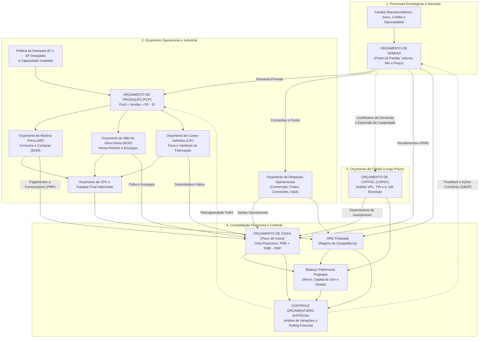

# PARECER TÉCNICO DE CONTROLADORIA Nº 001/2026

**PARA:** Conselho de Administração e Diretoria Executiva — Indústria Moveleira Vanguarda S.A.  
**DE:** Diretoria de Controladoria, Planejamento Financeiro (FP&A) e Governança Corporativa  
**RESPONSÁVEL TÉCNICO:** Caio Lucas Siqueira — Controller Financeiro  
**ASSUNTO:** Auditoria de Desvios Orçamentários, Diagnóstico de Falhas Estruturais no *Master Budget* e Plano de Reestruturação do Sistema de Gestão Financeira e Orçamentária  
**DATA:** Novembro de 2026  

---

## 1. SUMÁRIO EXECUTIVO E CONTEXTUALIZAÇÃO

O presente Parecer Técnico tem por finalidade apresentar à Alta Administração o diagnóstico técnico-científico acerca das severas distorções operacionais, econômicas e financeiras verificadas na elaboração e execução do Orçamento Empresarial (*Master Budget*) do exercício findo na **Indústria Moveleira Vanguarda S.A.**

Durante o ciclo orçamentário analisado, constatou-se uma sucessão de falhas metodológicas interconectadas que comprometeram a liquidez, a rentabilidade e a geração de valor econômico adicionado ($\text{EVA}^{\circledR}$) da companhia:

1. **Premissa Comercial Ingênua:** O orçamento de vendas foi projetado mediante mera repetição estática dos volumes comercializados no exercício anterior ($V_t = V_{t-1}$), ignorando variáveis macroeconômicas, elasticidade da demanda e a forte sazonalidade inerente ao setor moveleiro.
2. **Ruptura Técnica no Planejamento e Controle da Produção (PCP):** Desprezando a política interna de estoques mínimos e os saldos físicos remanescentes do período anterior, a programação fabril igualou linearmente o volume produzido ao volume orçado de vendas ($\text{Produção} = \text{Vendas}$).
3. **Desequilíbrio do Capital de Giro e Endividamento Oneroso:** Diante da frustração das vendas reais frente ao orçamento superestimado, a rigidez produtiva gerou superprodução, estocagem involuntária de produtos acabados e drenagem severa do fluxo de caixa operacional, forçando a captação recorrente de empréstimos bancários de curto prazo a taxas punitivas.
4. **Alocação Irracional de Capital (CAPEX):** Sob condições de restrição financeira, a companhia aprovou e executou simultaneamente dois projetos de investimento de capital **mutuamente exclusivos** (concorrentes entre si), duplicando desembolsos sem retorno incremental proporcional.
5. **Inexistência de Governança e Controle Orçamentário:** O exercício transcorreu sob um modelo de orçamento estático abandonado, sem acompanhamento mensal de desvios (*Orçado vs. Realizado*), decomposição de variações ou revisões periódicas de cenários (*Rolling Forecast*).

A seguir, cada eixo crítico é examinado à luz da doutrina consagrada de Controladoria e Finanças Corporativas — fundamentando-se em autores como **Padoveze (2015)**, **Frezatti (2018)**, **Gitman (2010)**, **Sanvicente e Santos (2008)**, **Assaf Neto (2021)**, **Welsch (2010)** e **Garrison, Noreen e Brewer (2013)** — acompanhado das diretrizes mandatórias para correção imediata do processo decisório.

---

## 2. ANÁLISE TÉCNICA DETALHADA DOS EIXOS CRÍTICOS

### ITEM A — O Encadeamento Orçamentário (*Master Budget*) e o Efeito Cascata do Orçamento de Vendas

#### A.1. O Orçamento Empresarial como Sistema Integrado e a Primazia do Orçamento de Vendas

Na arquitetura da Controladoria moderna, o orçamento empresarial (*Master Budget*) não constitui um agrupamento isolado de planilhas departamentais, mas sim um **sistema formal de informação e planejamento sistêmico** que traduz a estratégia corporativa em metas quantitativas e financeiras interdependentes (FREZATTI, 2018; WELSCH, 2010). Conforme leciona Padoveze (2015), o sistema orçamentário divide-se em três grandes blocos indissociáveis:

1. **Orçamento Operacional:** Compreende os orçamentos de Vendas, Produção, Consumo e Compras de Matérias-Primas (MP), Mão de Obra Direta (MOD), Custos Indiretos de Fabricação (CIF), Custos dos Produtos Vendidos (CPV) e Despesas Operacionais (Administrativas, Comerciais e Tributárias).
2. **Orçamento de Investimentos e Financiamentos (Capital Budget):** Contempla as aquisições e baixas de ativos imobilizados/intangíveis (CAPEX) e a estrutura de captação de recursos de longo prazo.
3. **Orçamento Financeiro (Consolidação Patrimonial):** Resulta na projeção do Fluxo de Caixa (Orçamento de Caixa), na Demonstração do Resultado do Exercício Projetada (DRE) e no Balanço Patrimonial Projetado.

Nesse arcabouço sistêmico, o **Orçamento de Vendas** ocupa a posição de **pedra angular e ponto de partida absoluto** de todo o processo de planejamento (*top-down/bottom-up*). Segundo Sanvicente e Santos (2008) e Garrison, Noreen e Brewer (2013), quando o fator restritivo de mercado é a demanda dos clientes — condição típica da indústria de transformação moveleira —, a previsão de vendas determina o nível de atividade de toda a organização. Nenhuma peça orçamentária subsequente pode ser dimensionada com fidedignidade sem que o volume, o *mix* de produtos e os preços de venda estejam rigorosamente validados.

#### A.2. Repercussão em Cascata sobre Produção, Custos Industriais (MP, MOD e CIF), Fluxo de Caixa e CAPEX

Um erro de estimação no Orçamento de Vendas propaga-se de forma multiplicativa por toda a cadeia orçamentária, fenômeno denominado na literatura como **Efeito Chicote Orçamentário** (*Bullwhip Budget Effect*):

* **Repercussão sobre o Orçamento de Produção e Estoques:** A meta física de vendas dita diretamente a necessidade de produtos acabados. Se a previsão comercial encontra-se superestimada, o Plano Mestre de Produção (PMP) é programado para um patamar artificialmente elevado, inflando a ocupação fabril para produzir bens sem demanda efetiva.
* **Repercussão sobre a Estrutura de Custos Industriais (MP, MOD e CIF):**
  * **Matéria-Prima (MP) e Insumos:** A partir da árvore de produto (*Bill of Materials* — BOM), o orçamento de produção dispara o orçamento de compras de madeira/MDF, ferragens, vernizes, espumas e embalagens. Uma previsão de vendas inflada leva o setor de Suprimentos a adquirir lotes excessivos de insumos, comprometendo o poder de barganha emergencial e gerando passivos com fornecedores que vencerão independentemente do sucesso das vendas.
  * **Mão de Obra Direta (MOD):** O dimensionamento de turnos, contratações de operadores de marcenaria/usinagem, horas-máquina e pacotes de horas extras subordina-se ao volume fabril projetado. Dada a rigidez da legislação trabalhista e os custos de rescisão e treinamento, o excesso de quadro contratado por falha de projeção comercial converte um custo teoricamente variável em um gasto fixo oneroso no curto prazo (PADOVEZE, 2015).
  * **Custos Indiretos de Fabricação (CIF):** Os custos indiretos variáveis (energia elétrica industrial, manutenção preventiva por hora-máquina, materiais auxiliares de lixamento e corte) crescem proporcionalmente à produção desnecessária. Simultaneamente, a taxa de absorção dos CIF fixos (depreciação fabril, supervisão, aluguel de galpão, seguros) sofre distorção contábil: ao produzir para o estoque e não para a venda, a empresa "ativa" custos fixos no Balanço Patrimonial (Estoque de Produtos Acabados), mascarando temporariamente o prejuízo na DRE até que a crise de liquidez se imponha.
* **Repercussão sobre o Fluxo de Caixa e o Ciclo Financeiro (PMR, PME e PMP):** Conforme Gitman (2010) e Assaf Neto (2021), o caixa opera pelo regime de realização financeira, regido pelo **Ciclo de Conversão de Caixa (CCC)**:
  $$\text{CCC} = \text{PME} + \text{PMR} - \text{PMP}$$
  Onde $\text{PME}$ é o Prazo Médio de Estocagem, $\text{PMR}$ é o Prazo Médio de Recebimento de clientes e $\text{PMP}$ é o Prazo Médio de Pagamento a fornecedores. Quando o Orçamento de Vendas falha (as vendas reais ficam abaixo do previsto), ocorrem três choques simultâneos:
  1. Os recebimentos operacionais ($Entradas_{t} = f(Vendas_{t - \text{PMR}})$) encolhem drasticamente;
  2. Os desembolsos com fornecedores ($Saídas_{t} = f(Compras_{t - \text{PMP}})$), salários e tributos sobre compras ocorrem integralmente conforme o orçamento inflado;
  3. O $\text{PME}$ explode devido ao acúmulo de móveis nos galpões, alargando a **Necessidade de Capital de Giro (NCG)** e gerando insolvência técnica de curto prazo.
* **Repercussão sobre o Orçamento de Capital (CAPEX):** O orçamento de investimentos em máquinas e expansão de capacidade apoia-se em duas premissas advindas do orçamento de vendas: (i) a necessidade física de ampliar a capacidade instalada para atender ao crescimento esperado da demanda; e (ii) a projeção de geração de **Fluxo de Caixa Operacional Livre** que financiará os desembolsos de implantação do projeto. Quando as vendas são superestimadas, a empresa investe em expansão fabril desnecessária (criando capacidade ociosa crônica) no exato momento em que sua geração interna de caixa seca, destruindo a estrutura de capital.

#### A.3. Diagrama Sistêmico do Fluxo do *Master Budget*

O diagrama a seguir ilustra a interdependência das peças orçamentárias e os vetores de contaminação verificados na indústria moveleira:

---

### ITEM B — Crítica à Estimação de Demanda e Metodologia para Projeção Consistente no Setor Moveleiro

#### B.1. Falácia do Método Ingênuo ($V_t = V_{t-1}$) e Suas Limitações no Setor Moveleiro

A decisão da diretoria comercial de estimar as vendas do exercício apenas replicando as quantidades vendidas no ano anterior ($V_t = V_{t-1}$, conhecido na econometria como modelo *Naive I* ou passeio aleatório sem *drift*) representa uma **negligência técnica grave**. Segundo Frezatti (2018) e Sanvicente e Santos (2008), a extrapolação passiva do passado pressupõe que o ambiente econômico e competitivo é estacionário e imutável — hipótese completamente inválida para a indústria de bens de consumo duráveis, como o setor de móveis.

As principais limitações estruturais dessa abordagem para a nossa indústria são:

1. **Desconsideração da Sazonalidade Intra-anual e Interanual:** O varejo e a indústria moveleira apresentam forte comportamento sazonal. O primeiro trimestre (janeiro a março) é historicamente retraído pelo comprometimento da renda familiar com despesas sazonais (IPTU, IPVA, material escolar e quitação de dívidas natalinas). Em contrapartida, o segundo semestre concentra picos expressivos impulsionados por feiras setoriais, Black Friday (novembro), pagamento do 13º salário e reformas residenciais de fim de ano. Tratar a demanda como estática ou meramente repetitiva distorce o giro mensal de caixa e estoque.
2. **Sensibilidade Macroeconômica e Condições de Crédito:** Móveis são bens duráveis de valor unitário relevante, cuja aquisição depende fortemente de **crédito ao consumidor (CDC, parcelamento no cartão)** e do custo do dinheiro. Elevações na taxa básica de juros (Selic) encarecem o financiamento no varejo, reduzindo imediatamente a conversão de vendas. Repetir o volume de um ano de juros baixos em um ano de aperto monetário gera superestimação crônica de receitas.
3. **Ciclo da Construção Civil e Mercado Imobiliário:** A demanda por móveis guarda correlação direta (com defasagem temporal ou *lag*) com o número de entregas de chaves de empreendimentos imobiliários (*habite-se*), volume de financiamentos habitacionais (SBPE/FGTS) e velocidade de vendas de imóveis usados. Ignorar o ciclo imobiliário cega a empresa quanto à demanda primária de mobiliário.
4. **Renda Disponível, Inflação e Elasticidade-Renda / Elasticidade-Preço da Demanda:** Diferentemente de alimentos e fármacos (bens inelásticos), o setor moveleiro possui **alta elasticidade-renda ($\varepsilon_R > 1$) e alta elasticidade-preço ($\|\varepsilon_P\| > 1$)**. Em cenários de compressão da massa salarial real pela inflação de alimentos e serviços essenciais, as famílias postergam a troca de sofás, armários e mesas. Além disso, repasses de custos de insumos (MDF, aço, espuma química) aos preços de tabela reduzem mais que proporcionalmente a quantidade demandada se não forem modelados via curva de elasticidade.
5. **Dinâmica Competitiva e Obsolescência de *Design*:** A repetição histórica ignora a entrada de concorrentes (inclusive *marketplaces* digitais de móveis prontos para montar — RTA), mudanças nas tendências arquitetônicas (compactação de apartamentos exigindo móveis multifuncionais) e o ciclo de vida das linhas atuais do portfólio.

#### B.2. Estrutura de uma Projeção de Vendas Consistente e Cientificamente Fundamentada

Para substituir o empirismo comercial, a Controladoria determina a implantação de um **Modelo Híbrido de Previsão de Demanda (Quantitativo + Qualitativo + Cenários)**, estruturado em quatro pilares complementares (PADOVEZE, 2015; WELSCH, 2010):

| Pilar Metodológico | Técnicas Aplicáveis | Aplicação Prática na Indústria Moveleira |
| :--- | :--- | :--- |
| **1. Modelos Quantitativos de Séries Temporais** | • Decomposição Clássica (Tendência $T$, Ciclo $C$, Sazonalidade $S$, Ruído $I$) • Suavização Exponencial Tripla de **Holt-Winters** (Aditiva/Multiplicativa) • Modelos **SARIMA** (Auto-Regressivos Integrados de Médias Móveis Sazonais) | Capturar o padrão histórico de no mínimo 36 a 60 meses por família de móveis (Cozinha, Dormitório, Estofados, Corporativo), isolando os índices sazonais mensais para calibrar a produção mês a mês. |
| **2. Modelos Causais e Econométricos (Regressão)** | • Regressão Linear Múltipla ($V_t = \beta_0 + \beta_1 \text{Juros}_t + \beta_2 \text{Renda}_t + \beta_3 \text{Habite-se}_{t-k} + \beta_4 \text{Preço}_t + \epsilon_t$) • Elasticidade Cruzada e de Preço | Quantificar matematicamente o impacto de variações na taxa Selic, índice de confiança do consumidor (ICC), entregas imobiliárias e reajustes de tabela sobre o volume físico demandado. |
| **3. Métodos Qualitativos Estruturados** | • **Método Delphi** (rodadas anônimas e convergentes com especialistas do setor) • Júri de Opinião de Executivos e Força de Vendas Regional • Pesquisa de Intenção de Compra com Lojistas/Varejistas (*Sell-in* vs *Sell-out*) | Incorporar inteligência de mercado não capturada no passado: lançamento de novas coleções, abertura de novos canais (e-commerce/exportação), nível de estoque atual nas lojas clientes e ações promocionais da concorrência. |
| **4. Simulação de Cenários e Análise de Sensibilidade** | • Construção de Cenários (**Pessimista / Conservador**, **Base / Mais Provável** e **Otimista**) • Simulação de Monte Carlo para variáveis críticas | Estabelecer faixas de operação e planos de contingência pré-aprovados. Se a venda real no 1º bimestre convergir para o Cenário Pessimista, gatilhos automáticos de contenção de produção e gastos são imediatamente acionados. |

---

### ITEM C — Planejamento e Controle da Produção (PCP), Equação de Estoques e Impacto no Capital de Giro

#### C.1. A Falha Conceitual da Igualdade $\text{Produção} = \text{Vendas}$ e a Equação Formal de Equilíbrio

Estabelecer o volume de produção como idêntico ao volume projetado de vendas ($\text{Produção}_t = \text{Vendas}_t$) constitui um erro elementar de Engenharia Econômica e Contabilidade de Custos. Tal igualdade só seria matematicamente válida em um sistema *Just-in-Time* puro sob produção 100% contra pedido (*Make-to-Order*) com estoque inicial nulo e estoque de segurança zero — realidade incompatível com a nossa fábrica, que opera com **política formal de estoque mínimo de produtos acabados** (*Make-to-Stock*) e possuía saldos remanescentes na abertura do exercício.

Conforme formalizado por Horngren, Datar e Rajan (2014), Garrison, Noreen e Brewer (2013) e Padoveze (2015), o **Orçamento de Produção em Unidades Físicas** deriva da equação fundamental de conservação de fluxos de estoques:

$$\text{Estoque Final (EF)}_t = \text{Estoque Inicial (EI)}_t + \text{Produção}_t - \text{Vendas Previstas}_t$$

Isolando a variável de decisão fabril ($\text{Produção}_t$) e incorporando a meta da política de estocagem ($\text{Estoque Final Desejado}_t$), obtém-se a **Equação Formal do Orçamento de Produção**:

$$\boxed{\text{Produção Requerida}_t = \text{Vendas Previstas}_t + \text{Estoque Final Desejado}_t - \text{Estoque Inicial}_t}$$

Quando a administração ignorou os termos $(\text{Estoque Final Desejado}_t - \text{Estoque Inicial}_t)$ e manteve a produção travada na previsão original de vendas mesmo diante da queda real de faturamento, criou-se um **desequilíbrio cumulativo**:

$$\text{Estoque Real Acumulado}_t = \text{EI}_0 + \sum_{k=1}^{t} \left(\text{Produção Orçada}_k - \text{Vendas Reais}_k\right)$$

Como $\text{Produção Orçada}_k = V_{t-1}$ e $\text{Vendas Reais}_k \ll V_{t-1}$, o diferencial positivo $(\text{Produção}_k - \text{Vendas Reais}_k)$ acumulou-se mês após mês nos armazéns sob a forma de estoques invendáveis no curto prazo.

#### C.2. Impacto Destrutivo sobre o Capital de Giro (Superprodução e Imobilização Financeira)

À luz da Teoria Dinâmica do Capital de Giro de Michel Fleuriet e das análises de Assaf Neto (2021) e Gitman (2010), a superprodução associada à queda de vendas provoca uma patologia financeira severa:

1. **Explosão da Necessidade de Capital de Giro (NCG):** A $\text{NCG} = \text{Ativo Circulante Operacional (Clientes + Estoques)} - \text{Passivo Circulante Operacional (Fornecedores + Salários + Impostos)}$. Quando a fábrica produz móveis que não são vendidos, ela converte disponibilidades líquidas (Caixa) e passivos exigíveis de curto prazo (Fornecedores de MDF/ferragens e Folha de MOD) no ativo circulante de **menor liquidez operacional**: o Estoque de Produtos Acabados.
2. **Alongamento do Prazo Médio de Estocagem (PME) e do Ciclo Financeiro:** O giro de estoques despenca, elevando o $\text{PME}$ de patamares saudáveis (ex.: 15 a 20 dias) para mais de 60 ou 75 dias. Como os fornecedores de matéria-prima e a folha salarial vencem em prazos curtos e rígidos ($\text{PMP} \approx 30\text{ dias}$), a empresa precisa financiar um hiato temporal crescente antes de ver qualquer centavo retornar das vendas.
3. **Custos Ocultos de Carregamento de Estoques (*Holding Costs*):** Na indústria moveleira, estocar produtos acabados gera custos elevados devido à baixa densidade cúbica (móveis ocupam grande volume físico por real investido):
   * **Custos de Armazenagem Física:** Aluguel de galpões adicionais, seguro contra incêndio (crítico em madeira/espuma), movimentação interna e controle de pragas/umidade;
   * **Perdas por Avaria e Obsolescência:** Móveis estocados por longos períodos sofrem empenamento por variação higrométrica, avarias de empilhamento e defasagem estética de *design* (forçando futuras liquidações com descontos de 30% a 50%, destruindo a margem bruta);
   * **Custo de Oportunidade do Capital Imobilizado:** Cada real congelado em caixas de móveis no depósito deixa de render a taxa livre de risco ou de abater passivos bancários onerosos (custo financeiro direto).

#### C.3. Requisitos de Dados e Variáveis para um Planejamento e Controle da Produção (PCP) Eficiente

Para que o PCP opere de forma integrada à Controladoria e ao processo de **S&OP (*Sales and Operations Planning*)**, é indispensável parametrizar o orçamento de produção com o seguinte conjunto de informações técnicas:

1. **Posição Física e Contábil do Estoque Inicial ($EI_0$):** Inventário auditado e segregado por SKU (produto acabado, semiacabado/em elaboração — WIP e matéria-prima), livre de itens obsoletos ou avariados.
2. **Política Parametrizada de Estoque de Segurança / Mínimo ($EF_{\text{desejado}}$):** Definida estatisticamente em função do nível de serviço desejado ($Z_{\alpha}$), do desvio-padrão da demanda ($\sigma_D$) e do tempo de reposição fabril (*lead time* $L$), tipicamente modelada como cobertura dinâmica dos próximos $k$ dias de vendas previstas (e nunca como um número estático desconectado da demanda futura).
3. **Previsão de Demanda Desagregada e Atualizada (*Rolling Forecast*):** Demanda prevista por SKU e por período (mensal/semanal), revisada mensalmente conforme a carteira real de pedidos (*backlog*).
4. **Capacidade Produtiva Instalada e Efetiva (Análise de Gargalos — TOC):** Disponibilidade de horas-máquina e horas-homem por centro de trabalho (corte, usinagem CNC, bordadeira, pintura/verniz, montagem e embalagem), identificando o recurso restritivo crítico conforme a Teoria das Restrições (Goldratt).
5. **Estrutura de Produto (*Bill of Materials* — BOM) e Roteiros de Fabricação:** Ficha técnica exata com consumo padrão de cada insumo por unidade produzida e tempos padrão de operação e preparação de máquina (*setup*).
6. **Lote Econômico de Produção (LEP) e Lote Mínimo de *Setup*:** Balanceamento entre o custo de preparação das máquinas (troca de ferramentas/cores na linha moveleira) e o custo financeiro de estocagem.
7. **Índices Técnicos de Perda Normal, Refugo e Retrabalho:** Percentual histórico de quebras de chapas de MDF, perdas de corte (plano de corte) e refugos de pintura para dimensionar a produção bruta necessária para atingir a produção líquida boa.
8. ***Lead Time* de Suprimentos (MRP — *Material Requirements Planning*):** Prazos de entrega dos fornecedores de matérias-primas críticas para sincronizar a chegada do insumo com a ordem de produção, evitando tanto paradas de linha quanto estocagem precoce de insumos.

---

### ITEM D — Gestão de Caixa, Avaliação de CAPEX sob Racionamento e Controle Orçamentário

#### D.1. Diagnóstico do Déficit de Caixa e o Custo Destrutivo dos Empréstimos de Curto Prazo

O saldo acumulado de caixa negativo observado em diversos meses do exercício é a consequência aritmética inevitável da combinação de três erros: **(i) frustração de receitas comerciais**, **(ii) desembolsos operacionais rígidos por superprodução** e **(iii) saídas maciças de caixa para dois projetos de CAPEX simultâneos**.

Sob a ótica da Administração Financeira (GITMAN, 2010; ASSAF NETO, 2021), a ausência de um **Orçamento de Caixa prospectivo** impediu a Tesouraria de antecipar os hiatos de liquidez. Quando uma empresa descobre o déficit de caixa no próprio dia ou semana do vencimento das obrigações, ela perde totalmente a capacidade de negociação bancária e recorre a linhas emergenciais de curtíssimo prazo (*Conta Garantida*, *Cheque Especial Empresarial*, *Hot Money* ou *Desconto de Duplicatas sem programação*).

Os efeitos deletérios dessa postura reativa são:
* **Custo Efetivo Total (CET) Exorbitante:** Linhas rotativas de curto prazo no mercado brasileiro praticam taxas entre **2,0% e 3,5% ao mês** (equivalentes a **26,8% a 51,1% ao ano**), acrescidas de IOF (Imposto sobre Operações Financeiras) e reciprocidades bancárias.
* **Efeito Bola de Neve (*Debt Spiral*):** As despesas financeiras geradas pelo saldo devedor de um mês são debitadas diretamente na conta corrente no início do mês seguinte, agravando o déficit de caixa subsequente e exigindo novos empréstimos apenas para pagar os juros dos anteriores.
* **Destruição do Lucro Operacional e do EVA:** Mesmo que a operação industrial apresente margem de contribuição positiva, uma taxa de captação de curto prazo superior ao Retorno sobre o Capital Investido ($\text{ROIC} < K_d$) transfere integralmente a riqueza gerada pela fábrica para as instituições financeiras.
* **Descasamento de Maturidades (*Maturity Mismatch*):** A empresa violou a **Regra de Ouro das Finanças Corporativas** ao financiar ativos permanentes de longo prazo (os dois projetos de CAPEX) e estoques de lento giro com dívidas bancárias de curtíssimo prazo.

#### D.2. Orçamento de Capital (CAPEX): Seleção de Projetos Mutuamente Exclusivos sob Racionamento de Capital

O segundo erro gravíssimo na esfera financeira foi a aprovação e incorporação simultânea de **dois projetos de investimento concorrentes (mutuamente exclusivos)** em um cenário de **recursos limitados (racionamento de capital)**.

Conforme estabelecem Gitman (2010), Sanvicente (2008) e Brealey, Myers e Allen (2018), projetos **mutuamente exclusivos** são aqueles que desempenham a mesma função econômica ou disputam o mesmo mercado/espaço físico — por exemplo, adquirir um Centro de Usinagem CNC Automatizado (*Projeto A*) **ou** adquirir uma Linha Semi-Automatizada Convencional Dupla (*Projeto B*) para o mesmo setor de corte e furação. A aceitação de um **elimina automaticamente** a possibilidade técnica e econômica de aceitação do outro, pois executar ambos gera duplicidade de investimento, subutilização crônica de ativos e canibalização dos fluxos de caixa incrementais.

Para a tomada de decisão racional no Orçamento de Capital, a Controladoria deve submeter os projetos concorrentes às três métricas fundamentais de Engenharia Econômica, descontadas pela **Taxa Mínima de Atratividade (TMA)** ou pelo **Custo Médio Ponderado de Capital (WACC — $k$)** da empresa:

1. **Valor Presente Líquido (VPL / *NPV*):** Mede a riqueza absoluta criada pelo projeto em moeda de hoje, descontando todos os fluxos de caixa operacionais incrementais ($FC_t$) à taxa $k$ e subtraindo o investimento inicial ($I_0$):
   $$\text{VPL} = \sum_{t=1}^{n} \frac{FC_t}{(1 + k)^t} - I_0$$
   * **Regra de Decisão em Projetos Mutuamente Exclusivos:** O **VPL é o critério soberano** (GITMAN, 2010). Entre dois projetos concorrentes ($A$ e $B$) que caibam no orçamento disponível, deve-se escolher **exclusivamente** aquele que apresentar o **maior VPL positivo** ($\max \{\text{VPL}_A, \text{VPL}_B\} > 0$), pois ele maximiza diretamente o valor de mercado da empresa.

2. **Taxa Interna de Retorno (TIR / *IRR*):** É a taxa de desconto intrínseca ($r = \text{TIR}$) que iguala o VPL do projeto a zero:
   $$\sum_{t=1}^{n} \frac{FC_t}{(1 + \text{TIR})^t} - I_0 = 0$$
   * **Regra de Decisão e Cautela Técnica:** O projeto é viável se $\text{TIR} > \text{TMA (WACC)}$. Contudo, ao comparar projetos **mutuamente exclusivos** de escalas (tamanhos de investimento $I_0$) diferentes ou perfis temporais de caixa distintos, a TIR isolada pode induzir a erro de classificação (conflito VPL vs. TIR devido à premissa implícita de reinvestimento dos fluxos intermediários à própria TIR). Nesses casos, prevalece o **VPL** ou calcula-se a **TIR Incremental ($\Delta \text{TIR}_{A-B}$)** do fluxo diferencial $(FC_A - FC_B)$ e a **TIR Modificada (TIRM)**.

3. **Índice de Lucratividade (IL / *Profitability Index*) sob Racionamento de Capital:** Expresso pela razão entre o Valor Presente dos benefícios futuros e o desembolso inicial:
   $$\text{IL} = \frac{\sum_{t=1}^{n} \frac{FC_t}{(1 + k)^t}}{I_0} = 1 + \frac{\text{VPL}}{I_0}$$
   * **Regra de Decisão:** O $\text{IL}$ mede o **"retorno por unidade monetária investida"** (eficiência do capital escasso). Sob racionamento de capital, o $\text{IL}$ permite hierarquizar projetos independentes, mas **respeitando estritamente a restrição de exclusividade mútua** — isto é, jamais se pode incluir na carteira dois projetos da mesma classe de concorrência ($X_A + X_B \le 1$, onde $X_i \in \{0, 1\}$).

> **Conclusão Técnica sobre o CAPEX:** A empresa deveria ter rejeitado liminarmente a execução conjunta ($X_A + X_B = 2$ é inviável por definição), selecionado apenas o projeto de maior VPL compatível com seu limite de capital (no caso estudado, o **Projeto A**) e escalonado seu desembolso em consonância com a geração de caixa operacional ou mediante linha específica de *Project Finance*/FINAME de longo prazo (com carência e juros subsidiados), preservando integralmente o caixa operacional.

#### D.3. Crítica à Ausência de Controle Orçamentário e Implantação da Governança Mensal (Análise de Variações e *Rolling Forecast*)

O quinto colapso gerencial relatado — encerrar o exercício fiscal com variações expressivas entre *Orçado vs. Realizado* sem nenhum registro de análise de desvios ou ações corretivas ao longo dos 12 meses — viola frontalmente o ciclo administrativo clássico (**Planejamento $\rightarrow$ Execução $\rightarrow$ Controle $\rightarrow$ Ação Corretiva**).

Conforme sentencia Frezatti (2018, p. 112), *"planejar sem controlar é uma falácia e um desperdício de tempo e energia organizacional"*. Um orçamento elaborado em novembro/dezembro e engavetado até dezembro do ano seguinte torna-se uma peça meramente burocrática. Para sanar essa lacuna, a Controladoria institui três mecanismos obrigatórios:

1. **Decomposição Mensal de Variações (Orçamento Estático vs. Orçamento Flexível):**
   Segundo Garrison, Noreen e Brewer (2013) e Padoveze (2015), comparar diretamente o Realizado com o Orçamento Estático original é insuficiente, pois mistura efeitos de volume comercial com efeitos de eficiência industrial. Ao fechamento de cada mês (até o 5º dia útil), a Controladoria deve emitir o **Relatório de Análise de Variações** decompondo o desvio total ($\Delta \text{Total} = \text{Real} - \text{Orçado Estático}$) em:
   * **Variação de Volume Comercial ($\Delta \text{Volume}$):** Diferença entre o Orçamento Flexível (ajustado ao volume real vendido/produzido) e o Orçamento Estático:
     $$\Delta \text{Volume} = (Q_{\text{Real}} - Q_{\text{Orçada}}) \times MC_{\text{Unitária Orçada}}$$
     *(Responsabilidade: Diretoria Comercial e Marketing).*
   * **Variação de Preço e Mix Comercial ($\Delta \text{Preço}$):**
     $$\Delta \text{Preço} = (P_{\text{Real}} - P_{\text{Orçado}}) \times Q_{\text{Real}}$$
   * **Variação de Eficiência e Custo Industrial ($\Delta \text{Eficiência}$ e $\Delta \text{Taxa/Preço de Insumo}$):** Comparação entre os custos reais incorridos e o custo padrão permitido para o volume efetivamente produzido (isolando desperdícios de matéria-prima, ociosidade de MOD e estouros de gastos de CIF).
     *(Responsabilidade: Diretoria Industrial e Suprimentos).*

2. **Controle Orçamentário Matricial (Gerenciamento Matricial de Despesas — GMD):**
   Cruzamento de **Pacotes de Gastos** (entidades contábeis: energia, fretes, viagens, manutenção, horas extras) com **Centros de Custo / Áreas de Responsabilidade**, evitando cortes lineares cegos e exigindo justificativa formal para qualquer rubrica que ultrapasse a banda de tolerância parametrizada (ex.: $\pm 5\%$).

3. **Substituição do Orçamento Estático Rígido pelo *Forecast* Periódico e *Rolling Forecast*:**
   Quando ficou evidente, já no encerramento do 1º trimestre (março), que as vendas reais estavam sistematicamente abaixo das premissas orçadas, o orçamento original perdeu sua aderência operacional. Com o **Forecast Revisado** e o **Rolling Forecast** (orçamento contínuo de 12 a 18 meses à frente, atualizado trimestralmente), a Controladoria teria:
   * Reduzido imediatamente as ordens de produção do 2º trimestre no processo de **S&OP**;
   * Renegociado entregas de matéria-prima com fornecedores antes que o estoque inchasse;
   * Suspenso desembolsos discricionários e postergado etapas de CAPEX não críticas, estancando a sangria de caixa antes da necessidade de empréstimos bancários.

---

## 3. PLANO DE AÇÃO EXECUTIVO DA CONTROLADORIA (MATRIZ 5W2H)

Para garantir que as falhas diagnosticadas não se repitam no próximo ciclo orçamentário, recomenda-se a aprovação imediata do seguinte plano de reestruturação:

| Eixo | O Quê (What) | Por Quê (Why) | Como (How) | Responsável (Who) | Periodicidade / Prazo (When) | Indicador de Controle (KPI) |
| :--- | :--- | :--- | :--- | :--- | :--- | :--- |
| **1. Demanda** | Implantar modelagem de previsão híbrida (Holt-Winters + Regressão + S&OP) | Eliminar o erro do método ingênuo ($V_t = V_{t-1}$) e capturar sazonalidade e macroeconomia | Série histórica de 60 meses, variáveis Selic/Crédito e validação com carteira de pedidos | Diretoria Comercial + FP&A | Mensal (Reunião de S&OP até dia 20) | **MAPE** (*Mean Absolute Percentage Error*) $< 8\%$ |
| **2. PCP e Estoques** | Parametrizar MRP/PCP pela equação $\text{Prod} = V + EF_{\text{min}} - EI$ | Evitar superprodução, ruptura ou imobilização excessiva de capital de giro | Trava sistêmica no ERP impedindo ordens de produção sem dedução do saldo físico inicial ($EI$) | Gerência Industrial / PCP | Semanal / Mensal | **PME** $\le 22\text{ dias}$ e Giro de Estoque $\ge 16\text{x/ano}$ |
| **3. Caixa e Giro** | Instituir Orçamento de Caixa Diário/Semanal de 90 dias (*Cash Flow Rolling*) | Antecipar déficits de liquidez e zerar captações emergenciais em conta garantida | Projeção de entradas (PMR) e saídas (PMP) com reserva mínima de caixa operacional | Tesouraria + Controladoria | Semanal (toda segunda-feira) | **Despesa Financeira de Curto Prazo** $< 0,5\%$ da Receita Líquida |
| **4. CAPEX** | Comitê de Investimentos com dossiê obrigatório (VPL, TIR, IL, Payback Descontado) | Impedir aprovação de projetos mutuamente exclusivos e respeitar o WACC e o limite de capital | Modelagem de fluxo de caixa descontado (FCD) auditada pela Controladoria antes de qualquer compra | Diretoria Financeira (CFO) + Controller | Antes de qualquer aprovação de CAPEX $> \text{R\$ } 50\text{ mil}$ | $100\%$ dos projetos com $\text{VPL} > 0$, $\text{TIR} > \text{WACC}$ e exclusividade validada |
| **5. Controle** | Implantar Fechamento Mensal de Variações (Orçamento Flexível) e *Rolling Forecast* | Garantir governança contínua, responsabilização de gestores e correção de rota tempestiva | Relatório de decomposição (Volume, Preço, Eficiência) e revisão trimestral das projeções | Controller Corporativo | Mensal (até 5º dia útil subsequente) | **Aderência ao EBITDA Revisado** $\ge 95\%$ |

---

## 4. CONCLUSÃO DO PARECER

Conclui-se que a crise de liquidez e a deterioração do resultado vivenciadas pela **Indústria Moveleira Vanguarda S.A.** não decorreram meramente de adversidades externas de mercado, mas fundamentalmente da **ruptura na cadeia de governança orçamentária**. O orçamento empresarial funciona como uma engrenagem de precisão: ao alimentar o sistema com uma premissa comercial irrealista ($V_t = V_{t-1}$), ignorar a equação básica de balanceamento de estoques ($\text{Produção} = \text{Vendas} + EF - EI$), alocar capital escasso em projetos concorrentes sem crivo de VPL/TIR/IL e operar às cegas durante doze meses sem controle de variações, a companhia transformou uma oscilação conjuntural de demanda em um grave desequilíbrio financeiro.

A adoção integral das diretrizes metodológicas apresentadas neste Parecer Técnico — amparada pela ferramenta computacional de simulação e controle desenvolvida pela Controladoria (`app.py`) — permitirá recuperar imediatamente a saúde do capital de giro, eliminar o endividamento oneroso de curto prazo e restaurar a capacidade de geração de valor sustentável aos acionistas.

---

## 5. REFERÊNCIAS BIBLIOGRÁFICAS

* **ASSAF NETO, Alexandre.** *Finanças Corporativas e Valor*. 8. ed. São Paulo: Atlas, 2021.
* **BREALEY, Richard A.; MYERS, Stewart C.; ALLEN, Franklin.** *Princípios de Finanças Corporativas*. 12. ed. Porto Alegre: AMGH / McGraw-Hill, 2018.
* **FREZATTI, Fábio.** *Orçamento Empresarial: Planejamento e Controle Gerencial*. 6. ed. São Paulo: Atlas, 2018.
* **GARRISON, Ray H.; NOREEN, Eric W.; BREWER, Peter C.** *Contabilidade Gerencial*. 14. ed. Porto Alegre: AMGH, 2013.
* **GITMAN, Lawrence J.** *Princípios de Administração Financeira*. 12. ed. São Paulo: Pearson Prentice Hall, 2010.
* **HORNGREN, Charles T.; DATAR, Srikant M.; RAJAN, Madhav.** *Contabilidade de Custos: Uma Ênfase Gerencial*. 14. ed. São Paulo: Pearson, 2014.
* **PADOVEZE, Clóvis Luís.** *Controladoria Estratégica e Operacional: Conceitos, Estrutura, Aplicação*. 3. ed. São Paulo: Cengage Learning, 2015.
* **PADOVEZE, Clóvis Luís; TARANTO, Fernando César.** *Orçamento Empresarial: Novos Conceitos e Técnicas*. São Paulo: Pearson Education do Brasil, 2009.
* **SANVICENTE, Antonio Zoratto; SANTOS, Celso da Costa.** *Orçamento na Administração de Empresas: Planejamento e Controle*. 2. ed. São Paulo: Atlas, 2008.
* **WELSCH, Glenn A.** *Orçamento Empresarial: Planejamento e Controle do Lucro*. 4. ed. São Paulo: Atlas, 2010.
