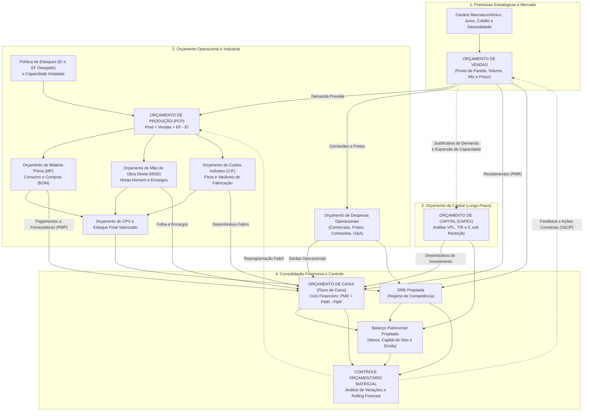

# 📊 Projeto Gestão Financeira e Orçamentária — Controladoria & FP&A


> **Estudo de Caso Executivo de Controladoria combinado com Engenharia de Software e Ciência de Dados em Python.**  
> Diagnóstico completo de desvios orçamentários (*Master Budget*), Simulador de Planejamento e Controle da Produção (PCP), Análise de Viabilidade Econômica de Projetos Mutuamente Exclusivos (VPL, TIR e IL) e Controle Matricial de Variações (*Orçado vs. Realizado*).

---

## 📖 Entenda o Projeto em 1 Minuto (Explicação Simples para Leigos)

Imagine uma **fábrica de móveis** que cometeu **4 erros básicos de planejamento** no último ano:

1. **Achou que ia vender igual ao ano passado:** Planejou vender **1.000 móveis por mês**, mas como os juros subiram, os clientes compraram bem menos (entre 680 e 940 na maior parte do ano).
2. **Fabricou móveis sem olhar para o galpão:** Mesmo vendendo menos e já tendo **350 móveis prontos** guardados no depósito, a fábrica continuou produzindo 1.000 móveis todo mês. Resultado: o galpão entupiu com **2.170 móveis encalhados (R$ 2,06 milhões parados em caixas!)**.
3. **Comprou duas máquinas iguais sem ter dinheiro:** A empresa precisava de uma máquina nova de corte e tinha duas opções concorrentes (*Projeto A* ou *Projeto B*). Em vez de escolher só a melhor, a diretoria **comprou as duas ao mesmo tempo**, gastando R$ 2,05 milhões de uma vez.
4. **Entrou no Cheque Especial e só olhou a conta em dezembro:** Faltou dinheiro para pagar madeira e salários, a conta bancária ficou **9 meses no vermelho** pagando juros altíssimos, e ninguém corrigiu a rota durante o ano.

👉 **O que este projeto faz?**  
Além do **Parecer Técnico Acadêmico** completo para a faculdade de Administração, construí um **Aplicativo Interativo em Python (`app.py`)** com um **"Modo para Leigos"**, onde qualquer pessoa pode clicar em um botão e ver na hora como consertar a produção da fábrica, destravar **R$ 1,91 milhão** do galpão, escolher a máquina certa e tirar a conta bancária do vermelho!

---

## 🎯 1. Contextualização Técnica do Problema de Negócio (*Business Case*)

Na elaboração e execução do orçamento anual de uma **indústria moveleira de médio porte (Indústria Moveleira Vanguarda S.A.)**, a ausência de integração entre as áreas Comercial, Industrial (PCP) e Financeira desencadeou cinco falhas críticas de governança orçamentária:

1. **Orçamento de Vendas Ingênuo ($V_t = V_{t-1}$):** A diretoria comercial projetou as vendas do exercício apenas repetindo o volume vendido no ano anterior ($1.000\text{ un./mês} = 12.000\text{ un./ano}$), ignorando a sazonalidade do varejo moveleiro, a elevação da taxa de juros (Selic) e a retração do crédito. As vendas reais fecharam o ano em $10.180\text{ unidades}$ ($-15,17\%$).
2. **Erro de Planejamento de Produção e Estoques ($\text{Produção} = \text{Vendas}$):** Mesmo possuindo política de estoque mínimo e um saldo inicial de $350\text{ unidades}$, a fábrica programou a produção igual às vendas orçadas ($1.000\text{ un./mês}$). Com a queda das vendas reais, o estoque de produtos acabados explodiu para **$2.170\text{ unidades}$**, imobilizando mais de **$\text{R\$ } 2,06\text{ milhões}$** em Capital de Giro.
3. **Colapso de Liquidez e Empréstimos de Curto Prazo:** A combinação de frustração de receita com compras excessivas de matéria-prima (MDF, ferragens, verniz) e folha de MOD levou o saldo acumulado de caixa ao vermelho por 9 meses consecutivos, forçando a tomada de linhas rotativas de curto prazo a taxas punitivas ($2,45\%\text{ a.m.}$).
4. **Alocação Irracional no Orçamento de Capital (CAPEX):** Sob restrição de capital, a diretoria aprovou e desembolsou simultaneamente **dois projetos de investimento concorrentes (mutuamente exclusivos)** — *Projeto A* ($\text{R\$ } 1,10\text{M}$) e *Projeto B* ($\text{R\$ } 0,95\text{M}$) — totalizando $\text{R\$ } 2,05\text{M}$ de saída de caixa sem ganho incremental proporcional.
5. **Ausência de Controle Orçamentário:** O exercício foi encerrado com desvios severos entre *Orçado vs. Realizado* sem que houvesse relatórios mensais de análise de variações (Orçamento Flexível) ou revisões de *Rolling Forecast*.

---

## 🏗️ 2. Arquitetura do Orçamento Empresarial (*Master Budget*)

O diagrama abaixo representa o encadeamento lógico das peças orçamentárias e como a falha na premissa primária (Vendas) contamina toda a estrutura operacional, patrimonial e financeira da companhia:



---

## 💡 3. Principais Insights do Parecer Técnico de Controladoria

O documento completo encontra-se em [`PARECER_TECNICO_CONTROLADORIA.md`](./PARECER_TECNICO_CONTROLADORIA.md), fundamentado em **Padoveze (2015)**, **Frezatti (2018)**, **Gitman (2010)**, **Sanvicente (2008)**, **Assaf Neto (2021)** e **Welsch (2010)**:

| Eixo Analítico | Diagnóstico da Falha | Solução Técnica Implementada | Impacto Quantitativo no Simulador |
| :--- | :--- | :--- | :--- |
| **A. Encadeamento (*Master Budget*)** | Erro de vendas propagou-se em cascata para MP, MOD, CIF, PME e Caixa. | Sincronização via **S&OP (*Sales and Operations Planning*)** e trava sistêmica entre demanda e compras. | Eliminação do efeito chicote orçamentário. |
| **B. Previsão de Demanda** | Método ingênuo ($V_t = V_{t-1}$) cego à sazonalidade e elasticidade-preço/renda. | Modelagem híbrida: Séries Temporais (**Holt-Winters / SARIMA**), Regressão Múltipla (Selic, Crédito, *Habite-se*) e **Método Delphi**. | Redução do erro de previsão (MAPE) e ajuste trimestral de cenários. |
| **C. PCP e Capital de Giro** | Regra errada $\text{Produção} = \text{Vendas}$ acumulou $2.170\text{ un.}$ em estoque final. | Aplicação rigorosa da equação $\text{Prod}_t = V_t + EF_{\text{desejado},t} - EI_t$. | Liberação de **$\text{R\$ } 1,91\text{ milhão}$** em Capital de Giro (NCG) e corte de $2.027\text{ un.}$ excedentes. |
| **D. Caixa, CAPEX e Controle** | Execução simultânea dos Projetos A e B (concorrentes) + ausência de controle mensal. | Seleção exclusiva pelo critério do **VPL ($\text{Projeto A} = +\text{R\$ } 418,4\text{ mil}$)**, **TIR ($28,39\%$)** e **IL ($1,38\text{x}$)** + **Orçamento Flexível e *Rolling Forecast***. | **Zeramento** da necessidade de empréstimos de curto prazo e preservação de caixa positivo o ano inteiro. |

---

## 🖥️ 4. Funcionalidades da Aplicação Interativa (`app.py`)

O dashboard construído em **Streamlit + Plotly** divide-se em 4 módulos estratégicos:

1. **📋 Aba 1 — Visão Geral & Parecer Executivo:** Cards de KPIs consolidados, gráfico de descolamento entre Vendas, Produção e Estoques, resumo executivo das falhas, diagrama Mermaid interativo e leitura/download do Parecer Técnico completo.
2. **🏭 Aba 2 — Simulador de Produção e Estoques (PCP):** Controles dinâmicos na barra lateral para parametrizar o Estoque Inicial ($EI_0$), Política de Estoque Mínimo ($\%$) e Aderência ao *Rolling Forecast*, recalculando em tempo real a produção correta e o capital de giro liberado.
3. **💎 Aba 3 — Orçamento de Caixa & CAPEX (VPL / TIR / IL):** Simulação do saldo acumulado de caixa sob diferentes escolhas de CAPEX, curva de Perfil do VPL em função do WACC/TMA e tabela decisória comparando o Projeto A, o Projeto B e o erro da aprovação conjunta.
4. **🎯 Aba 4 — Controle Orçamentário (*Orçado vs. Realizado*):** Gráfico de *Waterfall* (Ponte de Resultado) decompondo as variações de Volume Comercial, Preço, Estocagem e Juros, acompanhado dos gatilhos mensais onde o Controller deveria ter intervindo.

---

## 🚀 5. Como Executar o Projeto Localmente

### Pré-requisitos
* Python `3.10` ou superior instalado.

### Passo a Passo

```bash
# 1. Clone o repositório (ou acesse a pasta do projeto)
git clone https://github.com/seu-usuario/projeto-gestao-financeira-orcamentaria.git
cd projeto-gestao-financeira-orcamentaria

# 2. (Opcional) Crie e ative um ambiente virtual
python -m venv .venv
# No Windows (PowerShell):
.\.venv\Scripts\Activate.ps1
# No Linux/macOS:
source .venv/bin/activate

# 3. Instale as dependências
pip install -r requirements.txt

# 4. Execute o Dashboard e Simulador no Streamlit
streamlit run app.py
```

O aplicativo abrirá automaticamente no navegador em `http://localhost:8501`.

---

## 📂 6. Estrutura do Repositório

```text
📦 PARECER_TECNICO_CONTROLADORIA
 ┣ 📄 PARECER_TECNICO_CONTROLADORIA.md   # Trabalho acadêmico e Parecer Executivo fundamentado (Itens A, B, C e D)
 ┣ 🐍 app.py                             # Dashboard e Simulador Financeiro/Orçamentário em Streamlit & Plotly
 ┣ 📄 README.md                          # Documentação técnica e vitrine do projeto
 ┣ 📄 requirements.txt                   # Dependências do ecossistema Python
 ┗ 📄 POST_LINKEDIN.md                   # Copy estratégica para publicação e engajamento no LinkedIn
```

---

## 👨‍💻 Autor

**Caio Lucas Siqueira**  
*Administração, Finanças Corporativas, Controladoria & Análise de Dados em Python*

[](https://www.linkedin.com/in/caio-lucas-siqueira-7py)
